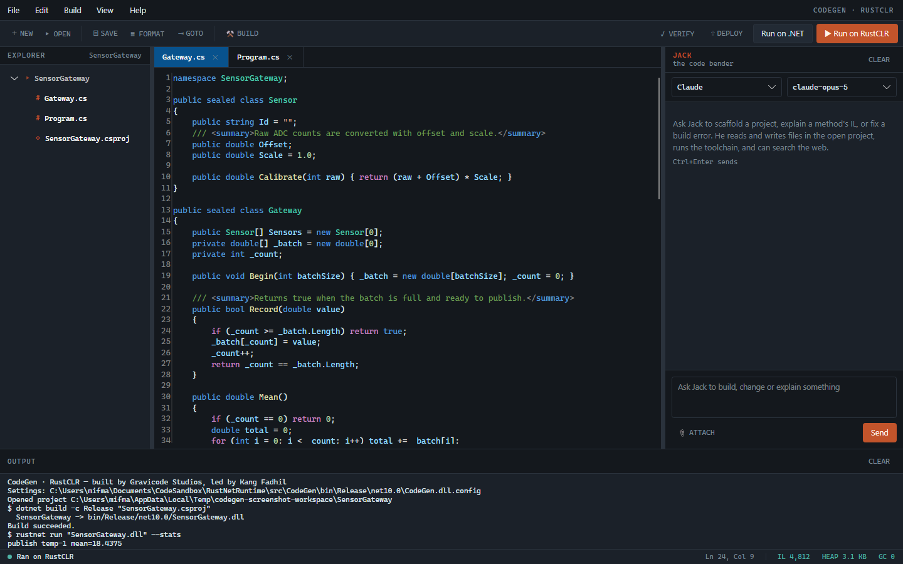
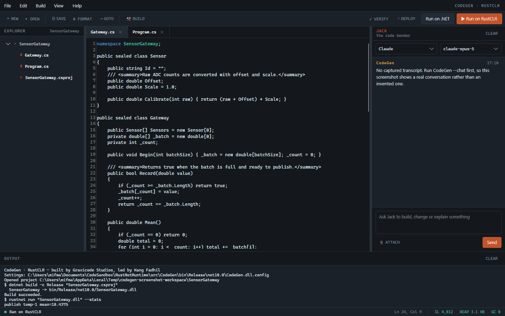
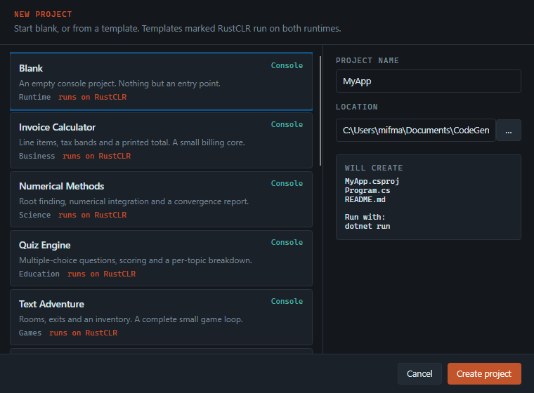
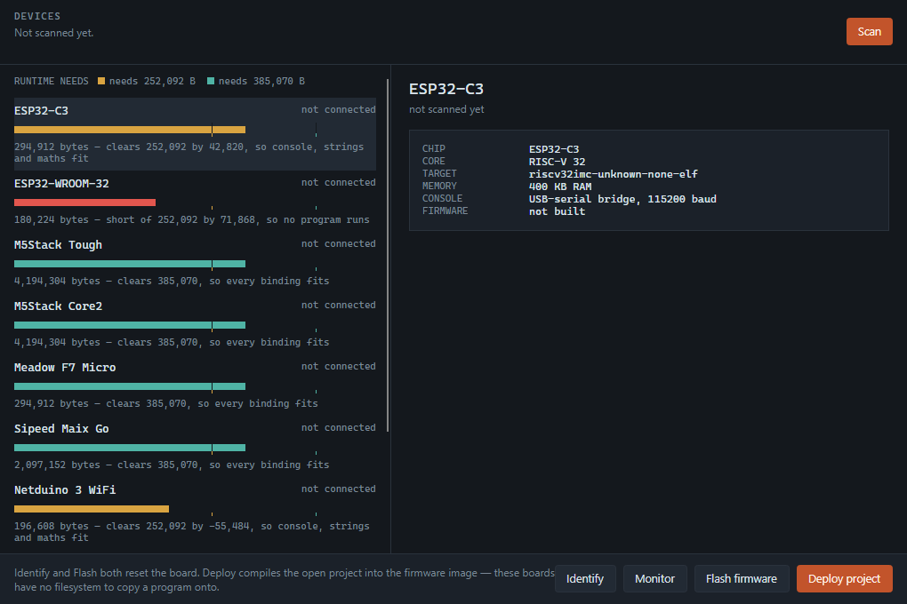
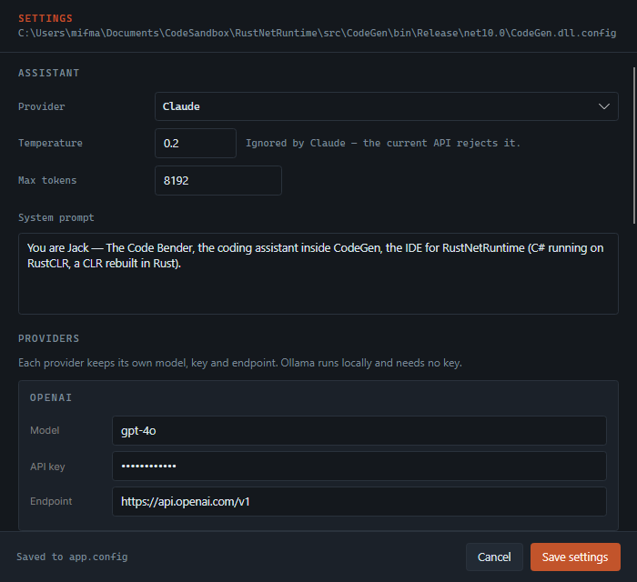

# RustNetRuntime

**C# di atas runtime yang ditulis ulang dengan Rust.**

*[Read in English →](README.md)*

RustNetRuntime menggantikan CoreCLR. C# tetap menjadi bahasa yang Anda tulis; di
bawahnya, runtime-nya — garbage collector, loader, mesin eksekusi, interop —
seluruhnya Rust. Ini bukan porting dari C++ milik CoreCLR, melainkan
implementasi ulang yang dibangun untuk memanfaatkan model keamanan memori dan
konkurensi Rust, bukan untuk menyalin aslinya baris demi baris.

Berdampingan dengan runtime ada **CodeGen**, sebuah IDE desktop dengan asisten —
*Jack, The Code Bender* — yang membuat kerangka proyek, menulis kode, dan
menjalankannya di kedua runtime tanpa keluar dari jendela.

---

## Sudah menjalankan assembly sungguhan

Inilah pengujian yang menentukan. Program C# yang dikompilasi Roslyn — dengan
pewarisan, interface, struct, enum, delegate, dan penanganan exception —
menghasilkan keluaran yang identik di kedua runtime:

```console
$ dotnet Conformance.dll
checks=361 failures=0

$ rustnet run Conformance.dll --stats
checks=361 failures=0

─── execution ──────────────────────────────
  wall clock                1367.141 ms
  IL instructions             844563
  throughput                  617759 instr/s
  managed calls                89024
  native calls                 47506
  compiled calls                 169
  methods compiled                19
  code emitted                  6603 bytes
  peak frame depth                32
─── heap ───────────────────────────────────
  collector               mark-sweep
  allocations                  46942
  bytes allocated            3774119
  collections                      0
  live objects                 46942
  peak live bytes            3774119
```

Bacalah wall clock dengan satu catatan: sebagian besar darinya adalah thread
yang sedang *tidur*. Pemeriksaan konkurensi benar-benar bertemu-janji dan
menunggu di thread OS sungguhan, jadi baris throughput membagi seluruh 844.563
instruksi dengan waktu yang sebagian besar dihabiskan dalam keadaan terblokir,
dan itu jauh meremehkan si interpreter. Pencacah di kanan-kirinya — instruksi,
panggilan, alokasi — akurat.

Ke-361 pemeriksaan itu mencakup aritmatika dan overflow, matematika `long`, alur
kontrol, string, array, pewarisan kelas, dispatch virtual dan interface,
property, struct, enum, boxing dan casting, `try`/`catch`/`finally`, filter
exception, handler bersarang, pembagian nol, delegate, generic, LINQ,
`async`/`await`, `Span<T>`, pointer mentah dan `stackalloc`, refleksi atas objek
`System.Type` sungguhan, thread nyata dengan `lock`, `Interlocked` dan
`Monitor.Wait`/`Pulse`, serta alokasi di bawah tekanan GC. Suite kedua,
`tests/fixtures/ModernSyntax/`, melakukan hal sama untuk 35 fitur C# modern.
Keduanya proyek C# biasa yang bisa Anda baca dan kembangkan.

`cargo test --workspace` menjalankan 416 test di dua puluh lima crate.

---

## CodeGen



Ruang kerja tiga panel: penjelajah berkas, editor dengan pewarnaan sintaks dan
nomor baris, serta asisten di sebelah kanan. Status bar menampilkan hal yang
justru menjadi inti proyek ini — apa yang dikerjakan runtime pada eksekusi
terakhir: `IL 4.812 · HEAP 3,1 KB · GC 0`.



Jack bukan sekadar jendela obrolan yang ditempelkan ke editor. Ia punya alat: ia
membaca dan menulis berkas di proyek yang terbuka, menyunting blok yang presisi
alih-alih menulis ulang seluruh berkas, melakukan build, menjalankan di kedua
runtime, membongkar IL, mencari di web, dan menghitung. Baris di bawah setiap
balasan mencantumkan alat yang benar-benar ia panggil.

Empat penyedia, satu antarmuka — **OpenAI**, **Claude**, **Gemini**, dan
**Ollama**. Semuanya lewat Semantic Kernel, sehingga alat asisten bekerja sama
persis apa pun pilihan Anda.



Dua puluh template yang mencakup proyek console, web, desktop, mobile, IoT,
dan library, lintas bidang bisnis, sains, edukasi, dan game. Template bertanda
*runs on RustCLR* berada dalam subset IL yang sudah dieksekusi runtime saat ini,
dan delapan template IoT-nya juga berada dalam himpunan binding yang muat di
papan kecil.

Klaim itu diperiksa, bukan sekadar dinyatakan. `CodeGen --verify-templates`
membuat setiap template, membangunnya, menjalankannya di kedua runtime, dan
membandingkan keluarannya byte demi byte — template yang menyasar papan
dijalankan dengan `--bcl minimal`, yaitu 300 binding yang sama seperti pada
papan 192 KB. Pemeriksaan itu menemukan tiga template yang memakai
`string + char` berbasis span yang belum diimplementasikan RustCLR, dan dua
celah runtime yang sebenarnya di baliknya.



**Devices** (`Ctrl+D`) menemukan papan yang tersambung, melaporkan identitasnya,
dan memasang firmware atau program Anda ke sana. Tiap papan digambar terhadap
dua angka yang menentukan apa yang bisa dijalankannya — 192.045 byte untuk
console, string, dan matematika, serta 260.702 byte untuk seluruh binding —
sehingga tier sebuah papan terbaca sebagai aritmetika, bukan sekadar label.
Batang Nucleo-F401RE yang berhenti sebelum tanda pertama adalah seluruh
penjelasan mengapa papan itu tidak bisa menjalankan program C#.

Deploy mengompilasi proyek yang terbuka **ke dalam** image firmware: papan-papan
ini tidak punya filesystem untuk menyalin assembly, jadi `RUSTCLR_APP` memberi
tahu build script firmware assembly mana yang harus disematkan. Untuk papan
dengan himpunan binding tereduksi, programnya dijalankan lebih dulu terhadap
batas itu di desktop — gagal di sana berarti gagal juga di papan, dan tidak ada
yang di-flash.



Setiap pengaturan tersimpan di `app.config` dan bisa diubah di sini — model,
API key, endpoint, temperature, system prompt, path toolchain, preferensi
editor, dan tata letak. Tidak ada tempat penyimpanan konfigurasi kedua.

---

## Kecepatan

Assembly yang sama di kedua runtime. Terbaik dari tiga kali jalan, wall clock
termasuk waktu start proses; .NET dibangun dengan tiered compilation dimatikan
agar JIT-nya berjalan penuh.

| Beban kerja | .NET | RustCLR | Rasio |
| --- | ---: | ---: | ---: |
| Rekursi (fib 27) — *dikompilasi* | 111 ms | **77 ms** | **0,7x** |
| Akses field (3 juta) — *dikompilasi, di-skalarkan* | 124 ms | **95 ms** | **0,8x** |
| Start proses | 84 ms | **73 ms** | **0,9x** |
| Sieve (1 juta) — *dikompilasi* | 93 ms | **85 ms** | **0,9x** |
| Perkalian matriks (120 kuadrat) — *dikompilasi* | 105 ms | **92 ms** | **0,9x** |
| Quicksort (200rb) — *dikompilasi, rekursif* | 123 ms | **109 ms** | **0,9x** |
| Aritmetika lewat metode pembantu — *dikompilasi, di-inline* | 111 ms | **97 ms** | **0,9x** |
| Panggilan virtual (2 juta) — *dikompilasi, di-devirtualisasi* | 118 ms | 129 ms | 1,1x |
| Exception (50rb throw) | 144 ms | 159 ms | 1,1x |
| Kernel bilangan bulat — *dikompilasi, memanggil pembantu terkompilasi* | 96 ms | 142 ms | 1,5x |
| Alokasi (300rb objek) — *dikompilasi* | 117 ms | 199 ms | 1,7x |
| Penelusuran array — *dikompilasi* | 135 ms | 244 ms | 1,8x |
| String (20rb concat) | 102 ms | 203 ms | 2,0x |

Bacalah bagian atas tabel itu dengan hati-hati, bukan dengan bangga. Start
proses memakan **73 ms**, dan setiap baris sampai quicksort berada dalam jarak
sekitar 35 ms dari lantai itu. Pembanding yang jujur adalah sejarah mereka
sendiri:

| Baris | dulu | sekarang | apa yang berubah |
| --- | ---: | ---: | --- |
| Sieve, matriks | ~1.500 ms | 85–92 ms | tiering mengompilasi metode yang badannya berulang |
| Akses field | 3.173 ms | 95 ms | objek yang tak lolos diganti oleh field-fieldnya |
| Panggilan virtual | 1.923 ms | 129 ms | devirtualisasi berpenjaga |
| Alokasi | 1.093 ms | 199 ms | safe point, lalu akses field terkompilasi |
| Aritmetika lewat pembantu | 477 ms | 97 ms | inliner belajar meratakan lebih dari satu tingkat |
| Kernel bilangan bulat | 350 ms | 142 ms | satu metode terkompilasi boleh memanggil metode terkompilasi lain |

**Kini setiap baris dikompilasi atau native**, dan tak ada yang lebih lambat
dari 2,0×. Yang terakhir bergerak adalah `kernels`, yang memecah pekerjaannya ke
metode pembantu yang *berulang* — sehingga tak bisa disisipkan pada kedalaman
inlining berapa pun, dan satu-satunya cara mengompilasi loop di sekelilingnya
adalah memberi kode terkompilasi konvensi pemanggilannya sendiri. `sort` ikut
terbawa, karena `Sort` memanggil `QuickSort`.

**Exception dan string tetap berdekatan** dengan .NET karena pekerjaannya
terjadi di Rust native di dalam RustBCL, bukan di IL yang ditafsirkan.

Checksum setiap baris dibandingkan antar-runtime sebelum diukur; kalau berbeda,
yang dicetak `MISMATCH`, bukan angka.

```bash
cd benchmarks && bash run.sh
```

Rincian: [docs/benchmarks.md](docs/benchmarks.md).

---

## Instalasi

**Windows:** installer dari [halaman rilis](https://github.com/DotNetVibeCoderz/Vibe_Runtime/releases)
(`RustNetRuntime-<versi>-win-x64-setup.exe`, atau arm64) menaruh `rustnet` di `PATH` dan CodeGen di
menu Start. **Linux, macOS:** arsip untuk platform Anda dari halaman yang sama, lalu
`./install.sh`. **Di mana saja yang ada .NET SDK:**

```bash
dotnet tool install -g RustNetRuntime    # perintah rustnet; berbeda dengan package RustNet
```

Atau bangun paket sendiri:

```bash
./packaging/build.sh              # untuk mesin ini
./packaging/build.sh linux-arm64  # atau Raspberry Pi, win-x64, osx-arm64
```

Lalu, dari paket yang sudah diekstrak:

```bash
./install.sh          # Linux dan macOS, ke ~/.local, tanpa root
install.ps1           # Windows, ke %LOCALAPPDATA%, tanpa elevasi
```

Keduanya menerima `--uninstall`. Sebuah paket berisi toolchain, CodeGen
self-contained, dokumentasi, dan sample: semuanya kecuali .NET SDK, yang tetap
Anda butuhkan untuk *mengompilasi* C#.

Panduan lengkap: [docs/installation.md](docs/installation.md).

---

## Memulai

**Prasyarat:** Rust 1.85+ dan .NET SDK 10.

```bash
# Build runtime dan toolchain
cargo build --release

# Kompilasi program C# dengan .NET SDK, lalu jalankan di RustCLR
cd tests/fixtures/HelloWorld
dotnet build -c Release
../../../target/release/rustnet run bin/Release/net10.0/HelloWorld.dll
```

```bash
# Jalankan IDE
dotnet run --project src/CodeGen
```

Isi API key di **Settings → Providers** untuk mengaktifkan Jack. Ollama tidak
butuh key; arahkan saja ke server lokal Anda dan pilih model.

Panduan lengkap: [docs/id/memulai.md](docs/id/memulai.md).

---

## Isi paket

| Komponen | Perannya |
| --- | --- |
| **RustCLR** | Runtime inti: garbage collector, sistem tipe, loader assembly, mesin eksekusi IL, penanganan exception |
| **RustBCL** | Base class library, diimplementasikan native dengan Rust — `Console`, `String`, `Math`, `Convert`, `StringBuilder`, `Array`, `GC`, dan lainnya |
| **RustNet Toolchain** | `rustnet` — build, run, inspeksi, disassembly, verifikasi, **debug**, dan **profil** assembly |
| **Interop Bridge** | P/Invoke ke library native, dengan marshalling dan pembungkus handle yang aman |
| **CodeGen** | IDE Avalonia beserta asistennya |

Dua puluh lima crate Rust:

```
rustclr-metadata   PE/COFF and ECMA-335 reader
rustclr-gc         Managed heap, pluggable collectors
rustclr-core       Type system, loader, IL interpreter
rustclr-bcl        Native base class library
rustclr-sched      Lock-free queue, channels, thread pool
rustclr-interop    P/Invoke and marshalling
rustclr-jit        Compilation interface and IL verifier
rustclr-hal        Board traits — the seam to the hardware
rustclr-hal-host   A simulated board, so device code runs on a desktop
rustclr-hal-k210   Kendryte K210 (RISC-V 64)
rustclr-hal-esp32c3  ESP32-C3 (RISC-V 32)
rustclr-hal-rp2040   RP2040 (Cortex-M0+)
rustclr-hal-stm32    STM32F4 and F7 (Cortex-M4F / M7)
rustclr-flashfs    Log-structured store for raw NOR flash
rustclr-crypto     SHA-256, HMAC, AES-CTR, CRC-32
rustclr-secureboot Signed image containers
rustclr-ota        A/B slots, verified images, automatic rollback
rustclr-gfx        RGB565 framebuffer, primitives, an 8x8 font
rustclr-mqtt       An MQTT 3.1.1 codec, transport-free
rustclr-usb        USB descriptors and device classes
rustclr-db         An embedded record store
rustclr-diag       Structured logging and health counters
rustclr-net        HTTP, Modbus, a small web server (host only)
rustclr-espat      Espressif AT commands, without a UART
rustnet-cli        The toolchain binary
```

Arsitektur lengkap: [docs/architecture.md](docs/architecture.md).

---

## Toolchain

```bash
rustnet run <assembly> [--stats] [--trace]   # jalankan di RustCLR
rustnet info <assembly> [--verbose]          # ringkasan metadata
rustnet disasm <assembly> [filter]           # bongkar ke IL
rustnet verify <assembly>                    # laporkan apa yang tidak ter-resolve
rustnet build [proyek] [--run]               # kompilasi, lalu jalankan di sini
rustnet capabilities                         # yang sudah diimplementasikan runtime
rustnet debug <assembly> --break File.cs:42  # berhenti pada satu baris sumber
rustnet debug <assembly> --dap               # bicara DAP, agar editor bisa attach
rustnet profile <assembly> [--top N]         # ke mana waktu pergi, dan apa yang dialokasikan
```

`verify` adalah perintah pertama yang layak dipakai saat memindahkan program:
ia menyebutkan setiap anggota yang dirujuk program tetapi belum bisa disediakan
RustCLR — sebelum Anda menjalankannya.

`profile` mengambil sampel di antara instruksi IL — tanpa thread pengambil
sampel, sehingga profiler yang sama berjalan di mikrokontroler — lalu melaporkan
waktu self dan inclusive per metode, jumlah pemanggilan yang eksak, serta
alokasi per tipe, dengan array dibebankan ke tipe elemennya. Yang diukur adalah
wall clock, yang diprofilkan adalah thread yang menjalankan `Main`, dan
semuanya diinterpretasi secara default karena kode terkompilasi tidak
menjalankan IL.

`debug` berhenti sebelum baris atau IL offset yang dipilih, melakukan step
into/over/out, dan menampilkan argumen serta local setiap frame — dengan nama
aslinya, selama portable PDB yang ditulis SDK ada di sebelah assembly. Dengan
`--dap` ia menjadi server Debug Adapter Protocol lewat stdin dan stdout, yaitu
protokol yang dipakai VSCode dan Rider.

Rujukan: [docs/cli.md](docs/cli.md).

---

## Yang sudah jalan, dan yang belum

Berterus terang soal ini lebih berguna daripada daftar fitur.

**Sudah jalan.** Kelas, interface, pewarisan, dispatch virtual dan interface,
value type, enum, delegate (unicast dan multicast), array, string dengan
semantik UTF-16 yang benar, boxing, casting, `try`/`catch`/`finally`,
constructor statis, P/Invoke, dan garbage collector yang menangani siklus.

**C# modern juga jalan.** Interpolasi string, tuple dan dekonstruksi, range dan
index (`a[^1]`, `a[1..4]`), nullable value type, property `init`-only, record,
pattern matching, switch expression, `new` bertipe-target, local function, dan
variabel `out`. `tests/fixtures/ModernSyntax/` menguji 35 di antaranya dan
melaporkan `failures=0` di kedua runtime.

**Koleksi dan LINQ.** `List<T>`, `Dictionary<K,V>`, `HashSet<T>`, `Queue<T>`,
dan `Stack<T>` diimplementasikan secara native, begitu pula LINQ — sekitar empat
puluh operator `Enumerable`, termasuk `GroupBy` dan `OrderBy`/`ThenBy`.

```csharp
var totals = orders
    .Where(o => o.Paid)
    .GroupBy(o => o.Region)
    .OrderBy(g => g.Key)
    .ToDictionary(g => g.Key, g => g.Sum(o => o.Amount));
```

Itu jalan, byte demi byte sama dengan .NET. Begitu pula `foreach` atas
`IEnumerable<T>`, atas iterator `yield return`, dan atas tipe apa pun yang
mengikuti pola enumerator.

Dua catatan, keduanya disebutkan `rustnet capabilities`: **LINQ bersifat eager**,
bukan lazy, sehingga efek samping di dalam predikat terjadi saat pemanggilan,
bukan saat konsumsi; dan pengurutan membandingkan angka dan string, serta
menolak tipe kunci lain alih-alih mengurutkannya secara sembarang.

**async dan await.** `Task`, `Task<T>`, `TaskCompletionSource`, `Task.Run`,
`Task.WhenAll`, dan pola awaiter sudah diimplementasikan, sehingga metode
`async` berjalan — termasuk exception yang dilempar melintasi `await` lalu
ditangkap pemanggilnya.

```csharp
static async Task<int> Chain(int n)
{
    int a = await Doubled(n);
    int b = await Doubled(a);
    return a + b;
}
```

Metode `async` bukan sesuatu yang istimewa bagi runtime: Roslyn menurunkannya
menjadi struct biasa ditambah panggilan ke sebuah *builder*, dan
mengimplementasikan builder itulah keseluruhan dukungan `await`. Catatannya sama
dengan yang dibawa `Thread` — **tidak ada tumpang tindih**. Sebuah task berjalan
sampai selesai di titik ia dibuat, jadi hasil dan urutannya benar, tetapi tidak
ada yang berjalan paralel.

**Reflection bekerja di atas objek `Type` yang sungguhan.** `typeof(T)`,
`GetType()`, base type, `IsAssignableFrom`, enumerasi anggota,
`MethodInfo.Invoke`, get dan set `FieldInfo`, serta `Activator.CreateInstance`.
Objek Type di-*intern* satu per tipe runtime, jadi `typeof(int) == typeof(int)`
adalah kesetaraan referensi. Custom attribute juga sudah didekode — argumen
konstruktor, named field, dan named property. `typeof(T)` atas parameter
generic yang sudah di-*erase* melempar exception alih-alih menjawab
`System.Object`.

**Sebagian metode dikompilasi menjadi kode mesin.** `rustclr-jit` menghasilkan
x86-64 ke dalam halaman write-xor-execute untuk metode yang mengerjakan
aritmetika `int` *dan* `double`. Di IL, `add` adalah opcode yang sama untuk
keduanya, jadi sebuah pass penentuan tipe menyimpulkan mana yang dimaksud dari
nilai-nilai yang sampai ke sana, dan **menolak metodenya ketika tidak sanggup
mengikuti alirannya** alih-alih menebak — tebakan yang salah akan mengembalikan
pola bit sebuah double sebagai bilangan bulat, dan begitulah bug itu benar-benar
ditemukan. Pada benchmark `kernels` hasilnya **11,0× lebih cepat** daripada
interpretasi — 269 ms berbanding 2.971 ms, yang memindahkannya dari 20× .NET
ke sekitar satu setengah kali.

**Metode yang badannya berulang dikompilasi pada panggilan pertama**, bukan
menunggu hitungan panggilan yang tak akan pernah tercapai oleh satu panggilan
berdurasi panjang. Selebihnya tetap menunggu 32 panggilan. Perubahan itulah yang
memindahkan `sieve` dan `matrix` dari sekitar 1.500 ms ke bawah 100 ms.

**Callee kecil di-*inline***, sehingga sebuah `call` tidak lagi membuat metode
ditolak. Benchmark `inlined` memakai aritmetika yang sama dengan `kernels`
tetapi dipecah menjadi metode pembantu, sebagaimana kode nyata ditulis: 1.629 ms
diinterpretasi, 400 ms dikompilasi — **2,9× di antaranya murni dari inliner**,
karena dengan `--no-inline` run yang sama memakan 1.148 ms. Hanya callee statik
tanpa percabangan yang disisipkan, dan hanya satu tingkat.

**Array ikut dikompilasi.** Sebuah `int[]`, `double[]` atau `bool[]` — baik
sebagai parameter maupun sebagai local — diserahkan ke kode terkompilasi sebagai
pointer data dan panjang, sehingga `a[i]` menjadi satu pemeriksaan batas dan
satu muatan berindeks-berskala, bukan pencarian handle. Benchmark `arrays`
berjalan **89,8× lebih cepat** setelah dikompilasi — 18.401 ms berbanding
205 ms, jarak terlebar di seluruh rangkaian.

**Kode terkompilasi mencapai safe point, sehingga boleh mengalokasikan di dalam
loop.** Ini pembatasan struktural terakhir pada backend. Kode terkompilasi tak
punya tempat untuk dihentikan, sehingga pengumpulan sampah tak bisa berjalan
selagi ia dieksekusi, sehingga loop yang mengalokasikan bisa menghabiskan heap
yang tidak akan dihabiskan oleh interpreter — dan aturannya dulu hanyalah
menolak.

Kini metode terkompilasi memeriksa di setiap back-edge loop, baik untuk
pengumpulan milik thread lain *maupun* untuk tekanan alokasinya sendiri, karena
dengan satu thread tak ada lagi yang akan meminta. Referensi hidup di frame
ditemukan dengan membaca offset byte yang ditetapkan saat metode dikompilasi:
poll-nya diletakkan di tempat stack evaluasi kosong, sehingga satu-satunya slot
yang penting adalah local dan argumen, dan jenisnya berasal dari tipe yang
dideklarasikan. Tak ada yang disimpulkan dari aliran instruksi. Back-edge yang
dicapai dengan stack tak kosong tidak mendapat safe point, dan metode itu tetap
memakai aturan lama.

Setiap safe point juga melepaskan apa yang sudah selesai dipakai loop, sehingga
**memori loop terkompilasi datar, bukan sebanding dengan jumlah putarannya**.
Itu bukan detail sepele: versi pertama dari ini menahan setiap alokasi tetap
hidup selama panggilan berlangsung — lolos semua uji kebenaran, dan justru lebih
buruk daripada menolak mengompilasi. Ada tes yang menjalankan loop yang sama
sepuluh kali lebih panjang dan gagal bila puncak heap-nya ikut naik.

**Satu metode terkompilasi memanggil metode terkompilasi lain.** Rekursi lebih
dulu — inliner tak bisa menghapusnya, karena menyisipkan metode ke dalam dirinya
sendiri tidak berhenti — lalu menyusul kasus umumnya. Panggilannya tak langsung,
lewat tabel alamat masuk yang diisi runtime sebelum si pemanggil berjalan, sebab
alamat sebuah callee belum ada ketika pemanggilnya dikompilasi dan dua metode
bisa saling memanggil. Itulah yang membuat `kernels` terkompilasi, yang metode
pembantunya mengandung loop sehingga tak pernah bisa disisipkan pada kedalaman
inlining berapa pun.

Panggilan terkompilasi berjalan di stack *mesin*, jadi runtime menghitung
**byte** yang dipakainya dan menolak melewati anggaran alih-alih crash. Byte,
bukan frame: ukuran frame berbeda-beda, sehingga hitungan frame apa pun akan
terlalu longgar bagi frame besar atau terlalu ketat bagi frame kecil — dan
hitungan yang ada sebelumnya diam-diam keduanya. Runtime memesan stack besar
untuk kode terkelola alih-alih berharap host menyediakannya, karena program yang
jalan saat ditafsirkan tidak boleh gagal saat dikompilasi.

**Panggilan virtual yang semua jawabannya diketahui menjadi sebuah
perbandingan.** Analisis hierarki kelas biasanya tidak bisa membuktikan apa pun
di sini, karena `Assembly.Load` bisa memasukkan subtipe belakangan — jadi ia
hanya dipercaya ketika hal itu mustahil: ketika tipe pendeklarasinya tidak
terlihat dari luar assembly-nya sendiri, sehingga tidak bisa diturunkan dari
luar. Kelas bersarang `private` adalah kasus yang lazim. Setiap override juga
harus melipat menjadi konstanta. Barulah panggilan itu menjadi pencarian tipe
runtime si receiver dan serangkaian perbandingan, tanpa panggilan sama sekali —
yang membawa `virtual` dari 1.923 ms menjadi 103 ms.

Tipe si receiver diambil lewat helper, bukan dibaca dari memori objeknya, jadi
tak ada bagian tata letak heap yang diasumsikan — satu-satunya yang dipegang
kode terkompilasi adalah handle, token 64-bit buram yang tak bisa ia
dereferensi. Receiver yang tak cocok dengan penjaga mana pun akan **trap**: di
sini tidak ada on-stack replacement, sehingga badan metode yang sudah
mengalokasikan tak punya jalan pulang yang sahih ke interpreter, dan bukti
hierarki yang ternyata keliru harus mengatakannya, bukan mengembalikan angka.

**Field sebuah objek di heap dicapai lewat panggilan helper, bukan lewat load
inline.** Heap menyimpan nilai dalam enum Rust dengan payload ter-box, yang
tata letaknya tidak dijamin bahasanya — memancarkan kode mesin yang membacanya
akan menjadikan tata letak itu bagian dari ABI backend ini, dan gagalnya berupa
*angka yang salah* pada hari sebuah kompiler menyusun ulang variannya. Sebuah
panggilan memang lebih mahal daripada satu load, tetapi tidak bisa salah dengan
cara seperti itu. Field `int`, `long`, `double` dan referensi bisa menyeberang;
field bertipe struct ditolak.

Jenis yang dideklarasikan **diperiksa**, bukan sekadar dipakai untuk
mengonversi. Referensi yang disimpan sebagai angka akan bolak-balik dengan
sempurna melalui kode terkompilasi namun tak terlihat oleh pengumpul sampah,
yang menelusuri referensi dan bukan bilangan bulat — sehingga rantai di
bawahnya tersapu selagi kode terkompilasi masih menyusurinya. Itu jawaban salah
yang tiba jauh setelah kesalahannya, jadi helper-nya menolak bentuk yang tidak
cocok dengan tipe yang dideklarasikan field itu.

**Objek yang tak pernah lolos berhenti ada.** Kode terkompilasi tidak membaca
field dari objek di heap, dan memang tidak akan pernah — field tersimpan di
`Vec<Value>`, dan `Value` adalah enum Rust yang tata letaknya tidak dijamin oleh
bahasanya, sehingga memancarkan kode yang membacanya akan menjadikan tata letak
itu bagian dari ABI si JIT, dan gagalnya berupa angka yang salah, bukan crash.
Sebagai gantinya, ketika sebuah objek terbukti tak pernah meninggalkan metode
yang membuatnya, setiap fieldnya menjadi local biasa: `ldfld` menjadi `ldloc`.
Itulah yang membawa `fields` dari 3.173 ms — baris paling lambat di seluruh
rangkaian — menjadi 104 ms. Pembuktiannya sengaja dibuat sempit, dan objek yang
dioper ke metode lain, dikembalikan, di-box atau dijadikan target `lock` ditolak
alih-alih ditebak.

Yang masih diinterpretasi disebutkan persis oleh `rustnet jit <assembly>`:
`float[]`, `rem` pada double, exception handling, dan akses field objek.
`rustnet run --no-jit` menginterpretasi semuanya, dan harus mencetak byte yang
sama — ada differential test yang menjaminnya.

**Fitur lanjutan C#.** 21 dari 21 fitur yang diuji menghasilkan keluaran identik
di kedua runtime: garbage collection, `IDisposable`/`using`, `async`/`await`,
threading dengan `lock` dan `Interlocked` (keduanya diserialkan — lihat
dokumennya), primary constructor, collection expression atas array, extension
members, P/Invoke, pattern matching, record, LINQ, source generator, dan
interceptor.

Celah yang tersisa adalah `Span<T>` dan marshalling struct, yang membutuhkan
argumen tipe generic yang sudah di-*erase*; TPL dan `await using`, yang memang
belum diimplementasikan; serta pointer unsafe, yang tidak bisa diekspresikan
referensi terkelola yang struktural. Union types dan closed hierarchies belum
ada di .NET 10 sama sekali — compiler mengurainya, tetapi tipe BCL yang
dibutuhkannya belum ada.

Matriks lengkapnya, beserta alasan tiap baris:
[docs/id/fitur-lanjutan.md](docs/id/fitur-lanjutan.md).


**Belum jalan.** Generic milik framework sengaja tetap di-*erase*: `List<int>`
dan `List<string>` adalah satu tipe runtime, karena setiap binding native
dikunci oleh nama tipe pendeklarasinya — memberi `List<int>` nama sendiri akan
membuat ``List`1::Add`` tak terjangkau. Generic buatan pengguna tidak di-erase:
`Cell<int>` dan `Cell<string>` adalah dua tipe dengan static slot
masing-masing. Call site yang menyebut definisi *terbuka* tetap ditolak: tidak
ada apa pun di sana yang tahu argumennya, jadi runtime mengatakannya alih-alih
menebak.

Penghasil kode native hanya untuk x86-64; **backend AArch64 dan RISC-V belum
pernah mengeksekusi satu instruksi pun.** Keduanya menyandikan IL yang sama
lewat translasi bersama yang sama dan diperiksa dengan disassembly, tetapi tak
ada papan yang pernah tersambung — dan backend yang belum pernah dieksekusi
namun mengaku bekerja lebih buruk daripada tidak ada backend sama sekali.

Yang masih ditolak backend x86-64: **penanganan exception**, karena frame
terkompilasi tak bisa di-unwind oleh interpreter; **metode instance**, yang
konvensi pemanggilannya tidak membawa receiver; `float[]`; `rem` pada double;
dan panggilan virtual lewat hierarki yang bisa diperluas assembly lain. Ini juga
bukan on-stack replacement: metode yang sedang berjalan tidak bisa ditukar.

`Monitor.Pulse` membangunkan *semua* penunggu, bukan satu. Itu janji yang lebih
lemah daripada .NET, dan sudah ditoleransi oleh `Wait` yang ditulis dalam loop
pemeriksaan ulang sebagaimana diwajibkan — dinyatakan di sini, bukan
ditutup-tutupi.

`rustnet capabilities` mencetak daftar ini langsung dari runtime, jadi tidak
bisa melenceng dari kenyataan. Rincian: [docs/limitations.md](docs/limitations.md).

---

## Target

Pembaca metadata mengenali x86, x64, Arm, Arm64, RISC-V 32, dan RISC-V 64.
**Seluruh runtime bisa dibangun tanpa `std`** — `rustclr-metadata`,
`rustclr-gc`, `rustclr-core`, dan `rustclr-bcl` — untuk
`thumbv7em-none-eabihf`, `thumbv6m-none-eabi`, `riscv32imc-unknown-none-elf`,
dan `riscv64gc-unknown-none-elf`. `bash tests/embedded.sh` memeriksa keenam
belas kombinasinya.

**C# berjalan di mikrokontroler.** Di sebuah ESP32-C3 — RISC-V, SRAM 400 KB,
tanpa sistem operasi — loader membangun type registry, RustBCL mendaftarkan
seluruh 826 native binding-nya, dan interpreter mengeksekusi
`HelloWorld.Main`:

```
-- il interpreter --
heap budget      294912 bytes
bcl tier         full (260702 bytes needed)
native bindings  821

--- program output ---
Hello from RustCLR
42
120
--- end ---
il executed      68
calls            6
```

Rekaman itu diambil saat papan terakhir tersambung; sejak itu RustBCL tumbuh
menjadi 826 binding. Angka pada kutipan adalah yang benar-benar dicetak chip,
bukan yang akan dicetak build hari ini.

Ketiga baris itu identik byte demi byte dengan keluaran
`dotnet HelloWorld.dll` di desktop, termasuk CRLF-nya, begitu pula
penghitungnya — 68 instruksi IL dan 6 pemanggilan, baik di x86-64 maupun di
RISC-V. Rekaman: [ESP32-C3, mengeksekusi](docs/logs/esp32c3-interpreter.log).

Ada tiga hal yang harus berubah, dan masing-masing adalah perbedaan nyata,
bukan tambalan: map menjadi `BTreeMap` (setiap kunci yang dipakai runtime sudah
`Ord`), `Arc` menjadi `Rc` (RISC-V `imc` tidak punya ekstensi atomic, dan
interpreter memang berjalan satu utas di chip), dan matematika float diambil
dari `libm` — satu-satunya dependensi eksternal di seluruh runtime, bersifat
opsional, dan tidak ikut terbawa pada build default. Hanya berkas yang tidak
bisa dihindari: `load_from_file` dipagari `std`, dan di chip sebuah assembly
datang sebagai byte.

**Seberapa banyak RustBCL yang muat bergantung pada papannya.** Puncak alokasi
adalah 260.702 byte dengan seluruh binding, atau 192.045 byte dengan console,
string, dan matematika saja — diukur, bukan ditaksir. Tiap firmware memilih
berdasarkan anggaran heap-nya, dan papan yang tidak memenuhi keduanya
menyatakannya dalam satu baris teks alih-alih mati di dalam allocator.

| Papan | Inti | RAM | Tier | Status |
| --- | --- | ---: | --- | --- |
| [ESP32-C3](embedded/esp32-demo) | RISC-V 32 | 400 K | penuh | **mengeksekusi IL di perangkat keras** |
| [ESP32-WROOM-32](embedded/esp32-demo) | Xtensa LX6 | 520 K | penuh | terbangun; flash terakhir sebelum interpreter |
| [Meadow F7](embedded/meadow-f7) | Cortex-M7 | 384 K | penuh | terbangun; flash terakhir sebelum interpreter |
| [Maix Go K210](embedded/k210) | RISC-V 64 | 6 M | penuh | **jalan** — menjalankan `HelloWorld.Main`, output identik dengan `dotnet` |
| [Netduino 3 WiFi](embedded/stm32f4) | Cortex-M4F | 256 K | minimal | terbangun; belum pernah di-flash — tidak ada papan |
| [Pico](embedded/rp2040) | Cortex-M0+ | 256 K | minimal | terbangun; belum pernah di-flash — tidak ada papan |
| [Nucleo-F401RE](embedded/stm32f4) | Cortex-M4F | 96 K | **tidak ada** | terbangun; belum pernah di-flash — tidak ada papan |

Baris terakhir adalah ujung jujur dari rentang ini: 96 KB berada di bawah
ambang batas lebih dari separuh, sehingga papan itu membaca assembly dan
mengumpulkan sampah tetapi tidak menjalankannya — dan image-nya 21 KB, bukan
282 KB, karena LTO membuang interpreter yang menurut konstantanya tidak akan
pernah terjangkau.

Ketujuhnya berbagi satu demonstrasi
([embedded/demo-common](embedded/demo-common)) dan `bash tests/firmware.sh`
membangun semuanya. **Tiga arsitektur sudah menjalankan interpreter di
perangkat keras** — RISC-V 32, RISC-V 64, dan Xtensa LX6, dari berkas sumber
yang sama: [ESP32-C3](docs/logs/esp32c3-interpreter.log) ·
[Maix Go K210](docs/logs/maixgo-k210.log) ·
[M5Stack Tough](docs/logs/m5stack-tough.log). Rekaman metadata-dan-GC
sebelumnya:
[Xtensa](docs/logs/esp32-wroom32.log) · [RISC-V](docs/logs/esp32c3.log) ·
[Arm](docs/logs/meadow-f7.log).

`Heap::embedded(n)` adalah batas keras, bukan sekadar petunjuk: alokasi
melampauinya gagal alih-alih tumbuh — satu-satunya jenis batas yang berarti di
perangkat yang RAM-nya sudah dianggarkan di muka. Profil Cargo `embedded`
melakukan build yang dioptimalkan untuk ukuran.

---

## Dokumentasi

- [Memulai](docs/id/memulai.md) · [English](docs/getting-started.md)
- [Instalasi](docs/id/instalasi.md) · [English](docs/installation.md)
- [Benchmark](docs/benchmarks.md)
- [Fitur lanjutan C#](docs/id/fitur-lanjutan.md) · [English](docs/advanced-features.md)
- [Arsitektur](docs/architecture.md)
- [Runtime secara mendalam](docs/runtime.md)
- [Panduan CodeGen](docs/id/codegen.md) · [English](docs/codegen.md)
- [Rujukan toolchain](docs/cli.md)
- [Template](docs/templates.md)
- [Batasan](docs/limitations.md)
- [Peta jalan](Plan.md) · [Progres](Progress.md)

---

## Berkontribusi

Test adalah kontraknya. `cargo test --workspace` harus tetap hijau, dan fixture
konformans harus terus melaporkan `failures=0` di kedua runtime.

**Koleksi dan LINQ.** `List<T>`, `Dictionary<K,V>`, `HashSet<T>`, `Queue<T>`,
dan `Stack<T>` diimplementasikan secara native, begitu pula LINQ — sekitar empat
puluh operator `Enumerable`, termasuk `GroupBy` dan `OrderBy`/`ThenBy`.

```csharp
var totals = orders
    .Where(o => o.Paid)
    .GroupBy(o => o.Region)
    .OrderBy(g => g.Key)
    .ToDictionary(g => g.Key, g => g.Sum(o => o.Amount));
```

Itu jalan, byte demi byte sama dengan .NET. Begitu pula `foreach` atas
`IEnumerable<T>`, atas iterator `yield return`, dan atas tipe apa pun yang
mengikuti pola enumerator.

Dua catatan, keduanya disebutkan `rustnet capabilities`: **LINQ bersifat eager**,
bukan lazy, sehingga efek samping di dalam predikat terjadi saat pemanggilan,
bukan saat konsumsi; dan pengurutan membandingkan angka dan string, serta
menolak tipe kunci lain alih-alih mengurutkannya secara sembarang.

**async dan await.** `Task`, `Task<T>`, `TaskCompletionSource`, `Task.Run`,
`Task.WhenAll`, dan pola awaiter sudah diimplementasikan, sehingga metode
`async` berjalan — termasuk exception yang dilempar melintasi `await` lalu
ditangkap pemanggilnya.

```csharp
static async Task<int> Chain(int n)
{
    int a = await Doubled(n);
    int b = await Doubled(a);
    return a + b;
}
```

Metode `async` bukan sesuatu yang istimewa bagi runtime: Roslyn menurunkannya
menjadi struct biasa ditambah panggilan ke sebuah *builder*, dan
mengimplementasikan builder itulah keseluruhan dukungan `await`. Catatannya sama
dengan yang dibawa `Thread` — **tidak ada tumpang tindih**. Sebuah task berjalan
sampai selesai di titik ia dibuat, jadi hasil dan urutannya benar, tetapi tidak
ada yang berjalan paralel.

**Reflection bekerja di atas objek `Type` yang sungguhan.** `typeof(T)`,
`GetType()`, base type, `IsAssignableFrom`, enumerasi anggota,
`MethodInfo.Invoke`, get dan set `FieldInfo`, serta `Activator.CreateInstance`.
Objek Type di-*intern* satu per tipe runtime, jadi `typeof(int) == typeof(int)`
adalah kesetaraan referensi. Custom attribute juga sudah didekode — argumen
konstruktor, named field, dan named property. `typeof(T)` atas parameter
generic yang sudah di-*erase* melempar exception alih-alih menjawab
`System.Object`.

**Sebagian metode dikompilasi menjadi kode mesin.** `rustclr-jit` menghasilkan
x86-64 ke dalam halaman write-xor-execute untuk aritmetika `int` dan `double`,
akses elemen `int[]`/`double[]`/`bool[]`, alokasi array, dan rekursi. Pada
benchmark `kernels` hasilnya **11,0× lebih cepat** daripada interpretasi —
269 ms berbanding 2.971 ms, jauh dari 20× .NET semula. Callee kecil
di-*inline*, sehingga sebuah `call` tidak lagi membuat metode ditolak.

**Backend AArch64 dan RISC-V ada, tetapi belum pernah dieksekusi.** Keduanya
meng-*encode* IL yang sama melalui translasi bersama yang sama seperti x86-64
dan diperiksa dengan cara membongkar (disassemble) keluarannya, tetapi belum
ada satu pun metode terkompilasi yang pernah berjalan di sana. Hanya x86-64
yang dipakai saat runtime.

Jangkauannya masih sempit, dan `rustnet jit <assembly>` menyebutkan persis
seberapa sempit: apa pun yang memakai array, alokasi, atau exception
handling tetap diinterpretasi. `rustnet run --no-jit` menginterpretasi
semuanya, dan harus mencetak byte yang sama — ada differential test yang
menjaminnya.

**Fitur lanjutan C#.** 21 dari 21 fitur yang diuji menghasilkan keluaran identik
di kedua runtime: garbage collection, `IDisposable`/`using`, `async`/`await`,
threading dengan `lock` dan `Interlocked` (keduanya diserialkan — lihat
dokumennya), primary constructor, collection expression atas array, extension
members, P/Invoke, pattern matching, record, LINQ, source generator, dan
interceptor.

Celah yang tersisa adalah `Span<T>` dan marshalling struct, yang membutuhkan
argumen tipe generic yang sudah di-*erase*; TPL dan `await using`, yang memang
belum diimplementasikan; serta pointer unsafe, yang tidak bisa diekspresikan
referensi terkelola yang struktural. Union types dan closed hierarchies belum
ada di .NET 10 sama sekali — compiler mengurainya, tetapi tipe BCL yang
dibutuhkannya belum ada.

Matriks lengkapnya, beserta alasan tiap baris:
[docs/id/fitur-lanjutan.md](docs/id/fitur-lanjutan.md).
 Ketika Anda
menambah kemampuan runtime, tambahkan pemeriksaan di
`tests/fixtures/Conformance/Program.cs` yang gagal tanpa kemampuan itu.

Screenshot di README ini dihasilkan otomatis, bukan diambil manual:

```bash
dotnet run --project src/CodeGen -c Release -- --screenshot docs/images
```

---

## Kredit

Dibuat oleh **Gravicode Studios**, dipimpin oleh **Kang Fadhil**.

Lisensi MIT.
